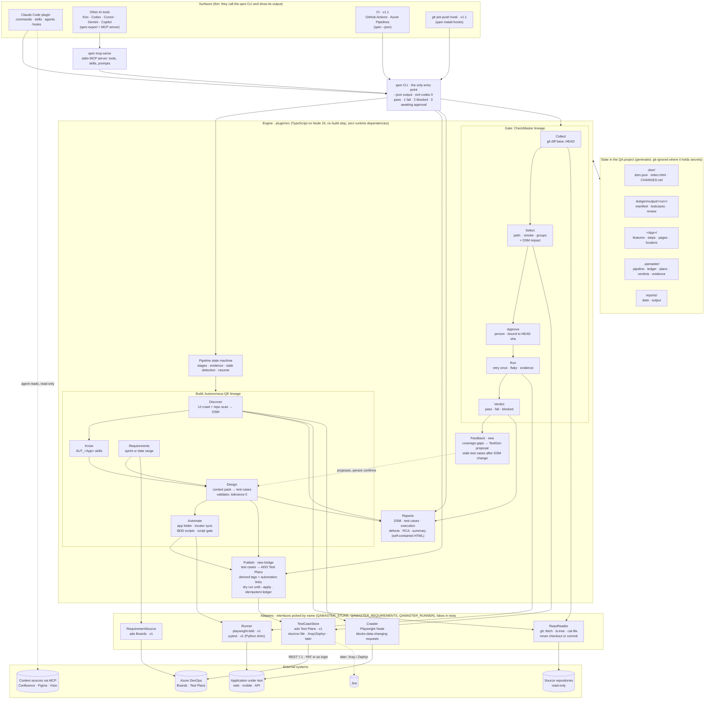
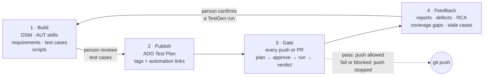
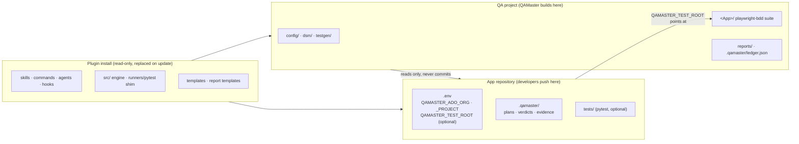
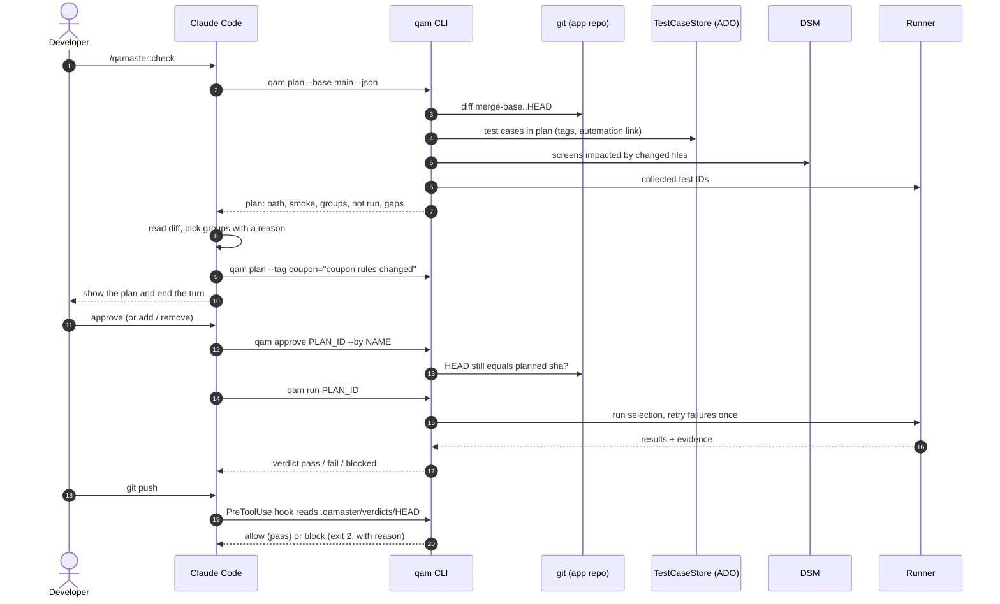
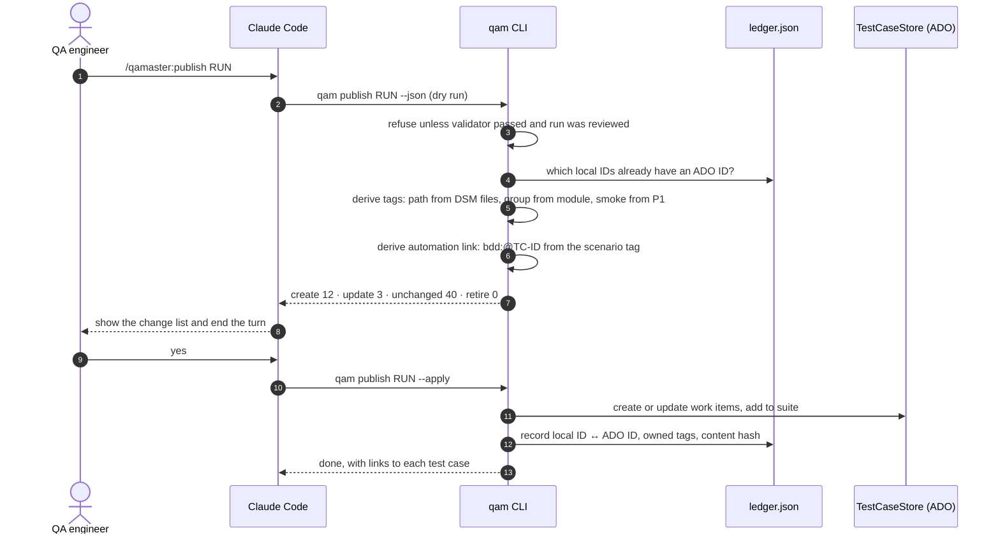

# QAMaster: Architecture

> Status: draft v0.1 (2026-10-28). For what and why, see [product.md](product.md). For behavior, see [design.md](design.md). For the stack and internals, see [tech.md](tech.md). Settled choices are in [decisions.md](decisions.md) as Q1, Q2, ...

QAMaster joins two existing Galent plugins into one loop:

- **Autonomous-QE** (TypeScript) builds test assets from an application URL and its repository: the Design Structure Matrix (DSM), application knowledge, requirements, test cases validated against evidence, Playwright BDD scripts and reports.
- **CheckMaster** (Python) gates each code change: it picks test cases from Azure DevOps Test Plans by tag, a person approves the pick, it runs the tests and records a verdict that blocks `git push`.

Neither does the other's job. Autonomous-QE's test cases never reach Azure DevOps, so nothing runs them against later changes. CheckMaster needs test cases that are already in Azure DevOps, with hand-set tags and automation links. QAMaster adds the bridge between them, **publish**, and closes the loop with **feedback**.

## 1. Full architecture

How to read it:

- **Everything goes through `qam`.** Commands, hooks, the MCP server and CI call the same CLI. The CLI is the only path into the engine, so Claude Code, CI and a terminal can't disagree about a verdict (Q3).
- **Two lineages, one engine.** The top half of the engine is Autonomous-QE's pipeline, the bottom half is CheckMaster's gate. Both were rewritten into one TypeScript engine with shared models (Q1).
- **Publish is the bridge.** It turns a validated test run into Azure DevOps test cases that the gate can select. The tags and automation links come from facts QAMaster already has, so nobody types them by hand (Q8, Q9).
- **Every external system sits behind an adapter.** The engine never calls Azure DevOps, git, a browser or a test runner directly (Q4).
- **The person decides at three gates:** test case review before publishing, the go-ahead before automating, and plan approval before each run (Q12).

## 2. The loop

| Step | Runs | Trigger | Output |
|---|---|---|---|
| 1 Build | Once per application, then module by module | `/qamaster:onboard` | `dsm/`, `.claude/skills/AUT_<App>*`, `testgen/output/`, `<App>/` |
| 2 Publish | After each reviewed test run | `/qamaster:publish` | Test cases in the ADO plan, `.qamaster/ledger.json` |
| 3 Gate | Every push (v1), every PR (v1.1) | `/qamaster:check`, push hook | `.qamaster/plans/`, `.qamaster/verdicts/<sha>.json`, evidence |
| 4 Feedback | After each verdict and each DSM refresh | Automatic, proposals only | Reports, defect drafts, gap list |

## 3. Where things run

QAMaster deals with three folders. The gate runs where the code is pushed; the build runs in the QA project.

- **Tests live in the app repo** (CheckMaster's setup): leave `QAMASTER_TEST_ROOT` unset. The runner runs from the repo root.
- **Tests live in the QA project** (Autonomous-QE's setup): set `QAMASTER_TEST_ROOT` to the `<App>/` folder. The gate reads the diff from the app repo and runs the suite from there (Q22).

## 4. The gate, step by step

## 5. Publish, step by step

## 6. Module map

| Module (`plugin/src/`) | Role | Comes from |
|---|---|---|
| `cli/` | Argument parsing, `--json`, exit codes, the only entry point | Both (CheckMaster's contract) |
| `pipeline/` | Onboarding stages, evidence, stale detection, resume | Autonomous-QE `tools/pipeline` |
| `dsm/` | UI crawl, repo scan, matrix build, diff, impact, HTML render | Autonomous-QE `tools/dsm` |
| `knowledge/` | AUT skill builder and context | Autonomous-QE `tools/aut-skill` |
| `requirements/` | JQL / WIQL planning, normalise, save | Autonomous-QE `tools/requirements`, now through the `RequirementSource` adapter |
| `testgen/` | Context pack, validator (tolerance 0), render | Autonomous-QE `tools/testgen` |
| `automation/` | App folder scaffold, locator sync, script quality gate | Autonomous-QE `tools/e2e-automation`, framework `scripts/locator-sync` |
| `publish/` | Tag and link derivation, ledger, dry run, apply | **New** |
| `gate/` | Collect, select, approve, run, verdict | CheckMaster `pipeline.py`, `selection.py`, `verdict.py`, ported |
| `feedback/` | Coverage gaps, stale cases, defect drafts | **New**, partly Autonomous-QE defect drafts |
| `reports/` | Report data builders and HTML | Autonomous-QE `tools/reports` |
| `adapters/` | `TestCaseStore`, `RequirementSource`, `Runner`, `RepoReader`, `Crawler` interfaces and implementations | CheckMaster `adapters/` pattern; ADO adapter ported |
| `export/`, `mcp/` | Export to other AI tools, stdio MCP server | Autonomous-QE `tools/export`, `tools/mcp_server` |
| `shared/` | Models, config, errors (`BlockedError`), paths | Both |

Outside `src/`:

| Path | Role |
|---|---|
| `plugin/runners/pytest/qamaster_pytest.py` | pytest plugin loaded with `-p` into the user's test environment. Standard library and pytest only. A port of CheckMaster's `pytest_plugin.py` |
| `plugin/hooks/` | Hook scripts: session context, push gate, test case review gate, script gate |
| `plugin/framework/` | The playwright-bdd template for new `<App>/` folders |
| `plugin/skills/`, `commands/`, `agents/` | Claude Code front ends, including about 45 domain, app-type and test-type design skills |
