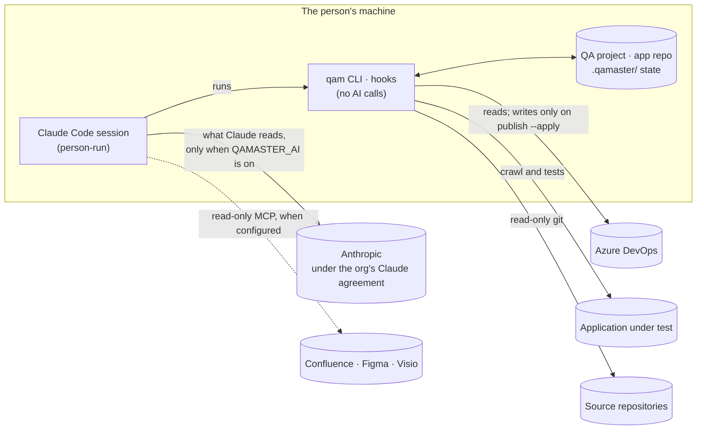

# QAMaster: Data handling

> Status: draft v0.1 (2026-10-28). Written for customers, security reviewers and Galent legal. Decisions: [Q24](decisions.md) (AI switch), [Q16](decisions.md) (secrets), [Q15](decisions.md) (read-only), [Q7](decisions.md) (publishing).

## In short

- **QAMaster itself makes no AI calls.** The `qam` CLI, its hooks, its MCP server and CI runs never contact Claude or any other AI service.
- **Claude sees data only inside a Claude Code session that a person runs.** QAMaster's commands and skills tell Claude to read certain files and command output. What Claude reads goes to Anthropic under the organization's own Claude agreement.
- **One setting turns QAMaster's AI steps off:** `QAMASTER_AI=off`.
- **Secrets never go to Claude.** They aren't printed, logged or stored by QAMaster, and Claude is blocked from reading `.env` files.
- **QAMaster sends no telemetry.**

## Where data goes

## What goes to Claude, and when

Only with `QAMASTER_AI` on (the default), and only in a Claude Code session.

| Step | What Claude reads | Why |
|---|---|---|
| Application knowledge | DSM contents (screens, elements, URLs, source file paths and line numbers) and the source files it opens | To write the `AUT_<App>` skills |
| Requirements | Requirement titles, descriptions and acceptance criteria fetched from ADO | To trace test cases to requirements |
| Context sources | Pages, designs or diagrams read through MCP (Confluence, Figma, Visio), only if configured | Background for test design |
| Test design | The context pack (screens, forms, fields, journeys, source file list), domain skills, generated test cases, validator findings | To write and fix test cases |
| Automation | Front-end source files for locators, generated scripts, script gate findings | To write features, steps and page objects |
| Gate: group picking | The `git diff` of the change being checked, and the plan | To pick the groups the change touches |
| Gate: results | The verdict and test errors. Screenshots or traces only if a person asks Claude to triage a failure | To explain failures and draft defects |
| Hooks | Short status messages: pipeline stage, stale warnings, why a push was blocked | Context for the session |

## What never goes to Claude

| Data | How it's kept out |
|---|---|
| ADO tokens, context-source tokens | Kept in environment variables or git-ignored `.env`, `.env.mcp`. Never printed by `qam`. `qam setup` adds deny rules for `.env*` to `.claude/settings.json`, so Claude can't read them even when asked |
| Application logins for the crawl | Typed in the terminal prompt of the crawl, or kept in git-ignored `.env.dsm`. Never asked for in chat |
| Anything from CI, the push hook or the MCP server on their own | They make no AI calls. Their output reaches Claude only if a person runs them in a session |

## With `QAMASTER_AI=off`

Set it in the app repo's `.env` or in the QA project's `config/qamaster.json`. If either says off, it's off.

| Still works | Stops, with a message naming the setting |
|---|---|
| DSM crawl and code scan (`qam dsm run`) | Application knowledge (`qam aut-context`, AUT-Skill-Builder) |
| Publishing an already-reviewed run | Test design (`qam testgen context`, TestGen) |
| The gate: plan from `path:`, `smoke` and DSM impact; approve; run; verdict; push hook | Locator sync context for script generation |
| Reports | Group picking. The plan says "Group picking off for this repo" |

**Limit:** the switch controls QAMaster's own steps. It can't stop a person from asking Claude to read files in the same session. Teams that must keep code away from Claude entirely should run `qam` from a terminal, not from Claude Code.

## Other systems QAMaster touches

| System | Reads | Writes |
|---|---|---|
| Source repositories | Files and history through `git fetch`, `ls-tree`, `cat-file` | Nothing. Never checks out, commits or pushes |
| Azure DevOps | Test plans, test cases, requirements | Test cases and suite membership, only on `qam publish --apply` or a confirmed work-items change. Removals are retirements, never deletes |
| Application under test | Pages during the crawl. Whatever the tests exercise | The crawl blocks data-changing requests after login. Tests run against production only after explicit confirmation |
| Context sources (MCP) | Scoped pages, files or diagrams | Nothing |

## Data kept on disk

| Where | What | Sensitive? |
|---|---|---|
| QA project `dsm/` | Screen and element inventory, URLs, source file paths | Describes the app's structure |
| QA project `testgen/output/`, `reports/` | Test cases, results, report HTML | May contain test data and error messages |
| App repo `.qamaster/evidence/` | Screenshots, videos and traces of failed tests | **Yes:** may show whatever the app displayed. Git-ignored by QAMaster's own `.gitignore` |
| `.env`, `.env.mcp`, `.env.dsm` | Secrets | **Yes:** git-ignored, and denied to Claude |

## For Galent legal

Open: **do Galent's customer contracts allow AI on customer code?**
- If yes for a customer, leave the default.
- If no, set `QAMASTER_AI=off` in their repos, or run QAMaster only from a terminal.

How long Anthropic retains data, and whether it's used for training, is set by the organization's Claude agreement, not by QAMaster.
