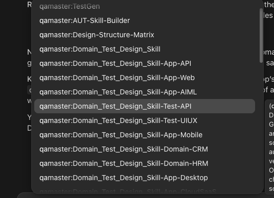

# QAMaster 0.1.0: manual walkthrough (OWASP Juice Shop)

Test QAMaster the way a new QA engineer would meet it: install it, point it at an app it has never seen, and go from nothing to reviewed test cases. Fill in the **Feedback** box after each step, while it's fresh. Short notes are fine.

| | |
|---|---|
| Tester | |
| Date | |
| Plugin | qamaster 0.1.0, installed at project scope from `~/claude-plugins/qamaster` |
| QA project | `~/Downloads/DemoTest1` (this folder) |
| App under test | [OWASP Juice Shop](https://github.com/juice-shop/juice-shop) v20.3.0, an Angular + Express web shop |
| App code | `~/Desktop/Workspace/juice-shop`, branch `demo-v20.3.0` (pinned to the tag, so the code matches the running app) |
| App URL | http://localhost:3000 |

**How to score each step:** ✅ worked as I expected · ⚠️ worked, but something was confusing or slow · ❌ broke or blocked me.

**What 0.1.0 can do:** setup, the onboarding pipeline, `doctor`, the Design Structure Matrix (DSM), application knowledge skills, TestGen (writing, validating and rendering test cases), recording a review, and read-only Azure DevOps checks.
**Not built yet:** publishing to ADO, fetching requirements, automation scripts, the change gate (`plan`, `check`, `run`), reports and hooks. If you hit one of these, it says "isn't built yet", which is expected. Note it only if the message itself is unclear.

**Why Juice Shop:** QAMaster was tuned on a React app. Juice Shop is new to it: Angular routing, Material dialogs, about 48 screens, and seeded users. It's a fair test of how QAMaster handles an unfamiliar app.

> ⚠️ Juice Shop is **deliberately insecure** (it's a security-training app). Run it only with the command below, which binds it to your own machine, and stop it when you're done.

---

## Step 0. Before you start

1. Start **Docker Desktop** and wait until it says it's running.
2. Start Juice Shop in its own terminal and leave it running:
   ```bash
   docker run --rm -p 127.0.0.1:3000:3000 bkimminich/juice-shop:v20.3.0
   ```
   Open http://localhost:3000. You'll see a welcome banner and a cookie notice over the shop. Close both.
3. Demo users: `jim@juice-sh.op` / `ncc-1701` (a normal customer, which QAMaster will use), and `admin@juice-sh.op` / `admin123`.
4. Optional: to test the Azure DevOps steps, have `QAMASTER_ADO_ORG`, `QAMASTER_ADO_PROJECT` and either `QAMASTER_ADO_TOKEN` or `az login` ready. Without them, you skip step 4b.

To stop the app later, press Ctrl+C in that terminal.

**Expected:** the shop loads at localhost:3000 and you can sign in as jim.

> **Feedback, step 0**
> Result: ✅ / ⚠️ / ❌
> What happened:
>
> What I'd change:
>give a little introduct and some tester emoji to look cool, use keyboard entry only like space --// etc not real emoji utf , so cxlaude can create them dynamically not needed to load

---

## Step 1. Open Claude in the QA project and check the plugin loaded

1. Start a new Claude Code session in `~/Downloads/DemoTest1`: a new session in the desktop app with that folder, or `cd ~/Downloads/DemoTest1 && claude`.
2. Type `/` and look for **`/qamaster:dsm`**.
3. Ask: *"What can QAMaster do in this project?"*

**Expected:** `/qamaster:dsm` is listed. Claude names the QAMaster skills: Design-Structure-Matrix, AUT-Skill-Builder, TestGen, Domain_Test_Design_Skill and ADO-API.

> **Feedback, step 1**
> Result: ✅ / ⚠️ / ❌
> Was it obvious the plugin was installed and what it's for?
>
> What I'd change:
>Almost good , I see a lot of test design skills preloaded (see image added below)but they should be used silently not for user use unless asked explicity by name or use or erquirement


---

## Step 2. Setup: point QAMaster at the app

1. Ask in plain English:

   > *"Set up QAMaster for JuiceShop. The app runs at http://localhost:3000 and its code is in /Users/sarvagya/Desktop/Workspace/juice-shop."*

   Claude should run `qam setup` with your answers. It installs Playwright and Chromium into this folder, which can take a few minutes. If Claude doesn't pick it up, run it yourself in a terminal in this folder:
   ```bash
   ~/claude-plugins/qamaster/plugin/bin/qam --repo . setup --app JuiceShop --url http://localhost:3000 --source /Users/sarvagya/Desktop/Workspace/juice-shop --entry claude-code
   ```
2. **Known gap, worth testing:** Juice Shop keeps about 30 copies of its router in `data/static/codefixes/`, for its code-fix challenges. QAMaster's default scan reads them and reports **489 routes instead of about 48**. Ask Claude:

   > *"Leave data/static/codefixes/ out of the code scan."*

   It should add the folder to `exclude` for the repository in `config/dsm-config.json`.

**Expected:** every setup step reports ok or done, and the code source shows `(demo-v20.3.0)`. The folder now has `config/qamaster.json`, `config/dsm-config.json`, `.qamaster/plugin.json` and `node_modules/playwright`. Running setup a second time changes nothing.

**Things to notice:** did it ask for anything it shouldn't need? Did it explain what it installed? Would you have noticeßd the 489 routes without being told?

> **Feedback, step 2**
> Result: ✅ / ⚠️ / ❌
> Did Claude run setup from the plain-English request, or did I need the command?
>
> Did the exclude request work the first time?
>
> Time it took:
>
> What I'd change:
>Re-running setup: none of the files changed (I compared file checksums before and after). But each re-run rewrites config/qamaster.json and still lists “updated” for the app, app URL and code source. A tester would reasonably think something changed. It should say “ok” when nothing is different.:Yes
>“Entry points” line: the output ends by asking you to pick which tools your team uses (Claude Code, VS Code and others). The walkthrough doesn’t mention this, so it’s unclear whether you need to do anything. You can ignore it for this walkthrough., once tickpoints are checked make hooks, plugin, skills for those resources also each ide or pilot knows what to use and understand projects

---

## Step 3. Onboarding status: what's next?

Ask: *"Where am I in QAMaster onboarding? What's next?"*
Or run it in a terminal: `~/claude-plugins/qamaster/plugin/bin/qam --repo . pipeline status`, then `... pipeline next`.

**Expected:** a list of stages (Setup, Test case store, Design Structure Matrix, Application knowledge, Requirements, Test cases, Review, Publish and later ones), each with its evidence. Setup is done. The next step is **Test case store**, with a clear instruction.

> **Feedback, step 3**
> Result: ✅ / ⚠️ / ❌
> Could I tell what to do next without reading any docs?
>
> What I'd change:
>looks good

---

## Step 4. Test case store (Azure DevOps)

### 4a. Without ADO (most testers)

Tell Claude: *"I don't have Azure DevOps for this demo. Skip the test case store."*
It should run `qam pipeline mark store skipped --note "…"`. The next stage becomes the DSM.

### 4b. With ADO (optional, read-only)

Put `QAMASTER_ADO_ORG` and `QAMASTER_ADO_PROJECT` in a `.env` file here (and the token, unless you use `az login`). Then ask: *"Run QAMaster doctor."*
To check write access without writing anything, ask: *"Can I write to our Azure DevOps project?"* (that's `qam doctor --check-write`).
Also try the ADO-API skill: *"List the test plans in our ADO project."*

**Expected:** doctor reports settings, credentials, the test plan and the runner, each with a clear fix when it fails. Nothing is created in ADO.

> **Feedback, step 4**
> Path taken: 4a / 4b
> Result: ✅ / ⚠️ / ❌
> Were the ADO errors (if any) clear about what to fix?
>
> What I'd change:
>When the project doesn’t exist, doctor passes on Azure DevOps’s raw error (TF200016…) and doesn’t list the projects that do exist. list them in that case and give suggestion from list also give suggestion for new name with option to edit to any custom, Also give one more option for local use xlsx,json,csv, etc , make this with latest fix (priority 1)
>qam ado call can’t list projects, because it only works inside a project. I had to call Azure DevOps directly to find out which projects exist., it should call with read only to organization and create with publish for projects(all things) 

---

## Step 5. Design Structure Matrix: map the app

1. Give QAMaster a way to sign in. Pick one:
   - **Saved test account:** create `.env.dsm` in this folder yourself, containing
     `DSM_APP_USERNAME=jim@juice-sh.op` and `DSM_APP_PASSWORD=ncc-1701`
   - **Sign in yourself:** `/qamaster:dsm run --login-mode manual` opens a browser window. Close the banner and cookie notice, then sign in as jim.
2. Type **`/qamaster:dsm`**. Keep Juice Shop running.
3. When it finishes, open `dsm/index.html` in a browser.
4. Ask about impact: *"Which screens does a change to frontend/src/app/address-create/address-create.component.ts affect?"* (that's `qam dsm impact`).

**Expected:** the code scan finds about 48 routes, and the crawl adds what it can reach as jim. Writes to the app (orders, reviews, complaints) are blocked during the crawl. `dsm/index.html` shows a square matrix you can click through. The impact answer names the address screens (`/address/create`, `/address/edit/:id`, and the saved and select address pages).

**Things to notice on this app:**
- Does the crawl get past the welcome banner and cookie notice, or do they block it?
- Does automatic sign-in work with Juice Shop's login form?
- Admin-only screens (`/administration`, `/accounting`) should show as unreachable for jim, not as errors.
- Claude should never ask you for the password in chat. Note it if it does.

> **Feedback, step 5**
> Result: ✅ / ⚠️ / ❌
> Routes in code / screens crawled / navigations:
>
> Did the banner, cookie notice or sign-in get in the way?
>
> Was the matrix page understandable? What would I want to see on it?
>
> What I'd change:
> it should ask user for the test user creds if not foundd in code and store it in a hidden maner, so leaks happen 
>While DSM runns try to show gaphics of whats it reading , doing creating relation in goods manner
>The TSM build can we multhread and multiprocessing with batch or comboination or permutation of different things to speed up the process by a lot (I want plugin to be very fast at all steps)
>it should also support multilanguage project and graph project later in v3(i meant it understand unit (can be microservices)projects and use it to make the full picture for bigger project)
>Also while building suggest walkthough for other service which doesnt directly depend on the obove, eg setting up testplaner tool etc etc
>Hash routes: the setting for #/ routes is set to “auto”, but it didn’t apply them to the routes from the code. Opening /wallet instead of /#/wallet shows the home page, so those code routes may end up marked “ui-only” or “code-only”, or matched to the wrong screen. I’ll check that in the final matrix.
>Speed: crawling Juice Shop is slow, and the reason is the welcome banner plus a page that never stops polling. That’s useful to report.
>A long crawl that can’t be resumed is risky on a slow app like Juice Shop. Being able to continue from where it stopped, or to re-crawl just chosen routes, would help. The code already has a way to crawl only some screens, but it’s only used for code changes.
>Pages a run never reached should be marked “not crawled”, not “broken”.
>Make strategy give initail dsm first for basic lookup and in BE ask to start deep analysis
---

## Step 6. Application knowledge: teach Claude the app

Ask: *"Build the AUT skills for this app."*

**Expected:** Claude uses the AUT-Skill-Builder skill and runs `qam aut-skills`. Skills appear under `.claude/skills/AUT_JuiceShop*`, one per part of the app, with business understanding and end-to-end cases written from the code. Check what it learned: *"What does the address book do, and what are its rules?"*

> **Feedback, step 6**
> Result: ✅ / ⚠️ / ❌
> Number of skills:
>
> Was what it learned about the app accurate?
>
> What I'd change:
>
>“Done” too early: pipeline status marks app knowledge as done while 34 of 35 skills are still template text. It only checks that the skills match the matrix.
>Wrong router: each screen’s “Route defined at” points to the copies in data/static/codefixes/ instead of the real router, app.routing.ts:93-111. This is the known routes problem showing up again.
>No forms found: every address screen shows 0 forms and no fields, because the crawl opened them without #/. The form details came only from my reading of the code.
>“Address” is fine: writing into .claude/skills worked without being blocked.
>Names: the overview names the home page component /web3-sandbox#/, because that’s where the last copy of the home page was seen.
---

## Step 7. Requirements (skip in 0.1.0)

Fetching sprint stories isn't built yet. Tell Claude: *"Skip requirements for now."* It should mark the stage skipped with a note.

> **Feedback, step 7**
> Result: ✅ / ⚠️ / ❌
> Notes:
>

---

## Step 8. TestGen: write test cases

1. Ask: *"Write test cases for the address module."* (adding and editing a delivery address).
2. Watch it get the facts (`qam testgen context`), write the run, and validate it (`qam testgen validate`) until it passes with **0 findings and 0 coverage gaps**, then render it (`qam testgen render`).
3. Open the run folder `testgen/output/<date>-<module>/` and read `testcases.md`. Also look at the `.feature` and `.csv` files.
4. Check the rules against the code. The form's real rules are in `frontend/src/app/address-create/address-create.component.ts`, lines 34–39:
   - every field is required;
   - mobile number between 1111111 and 9999999999;
   - ZIP code at most 8 characters;
   - address at most 160 characters.

   You should see boundary cases for these, citing those lines.
5. Try to catch it out: ask it to *"add a test for the Use my current location button on the address form"*. That button doesn't exist, so it should refuse or report a gap, not invent it.

**Expected:** every step names a real screen and element, and business rules cite code lines. Nothing is shown as done before validation passes.

> **Feedback, step 8**
> Result: ✅ / ⚠️ / ❌
> Number of test cases / categories covered:
>
> Did it find all four rules, with the right boundaries?
>
> Quality as a QA engineer would judge it (realistic? missing cases? wrong expectations?):
>
> Did the made-up-button check hold?
>
> Time it took:
>
> What I'd change:
>Walkthrough feedback for step 8 (❌, blocker): on a hash-routed app like Juice Shop, TestGen can’t write form cases at all, because the map never sees the forms. The cause traces back to step 5: code routes are crawled without #/. The walkthrough’s “Expected” (every step names a real screen and element) can’t be met until that’s fixed.

---

## Step 9. Review: approve the test cases

1. Read the test cases. Ask for any changes you want, then re-check that validation still passes.
2. Say **"yes, I approve this run"**.

**Expected:** only after your yes, Claude runs `qam review <run>`, which records you (git email, plus ADO account if set) as the reviewer. Claude must not record a review without your explicit reply. If the files change after the review, `pipeline status` shows the review as stale.

> **Feedback, step 9**
> Result: ✅ / ⚠️ / ❌
> Did it wait for my approval? Was it clear what "review" records?
>
> What I'd change:
>

---

## Step 10. Status at the end

Ask: *"Show QAMaster onboarding status."*

**Expected:** Setup, DSM, knowledge, test cases and review are done. Store and requirements are done or skipped. Publish is next, and it reports "not built yet" if you try it.

> **Feedback, step 10**
> Result: ✅ / ⚠️ / ❌
> Notes:
>


Stage	State	Note
Setup	✅ done	
Store	⏭ skipped	ADO project testDemo1 doesn’t exist; local CSV workaround
DSM	✅ done	55 screens, 132 relations
App knowledge	✅ done	All AUT skills current
Requirements	pending	Optional — skip or fetch
Test cases	✅ done	20261030-0900-Address validated
Review	✅ done	Signed off by you
Publish	pending	Next: push cases to ADO (blocked by store)
---

## Overall feedback

Automation → Gate	pending	Feature file exists; scripts not yet written


> **Top 3 things that worked well**
> 1.
> 2.
> 3.
>
> **Top 3 problems (most painful first)**
> 1.
> 2.
> 3.
>
> **Where I got stuck or had to guess**
>
>
> **Messages or wording that confused me**
>
>
> **What I expected QAMaster to do that it didn't**
>
>
> **How did it handle an app it wasn't tuned on (Angular, dialogs, sign-in)?**
>
>
> **Would I use this on a real project? Why or why not?**
>
>
> **Overall score (1–5):**

---

### If you need to start over

- Re-run a step: setup is safe to re-run, and `/qamaster:dsm refresh` updates the DSM.
- Fresh start: close Claude, delete everything in this folder except `.claude/`, `.git/` and this walkthrough, then begin at step 2.
- New plugin build: delete `~/claude-plugins/qamaster`, unzip the new zip there, then from this folder run `claude plugin uninstall qamaster@qamaster-local --scope project` and `claude plugin install qamaster@qamaster-local --scope project`.
- Done testing: press Ctrl+C in the Juice Shop terminal. The `--rm` flag removes the container.
