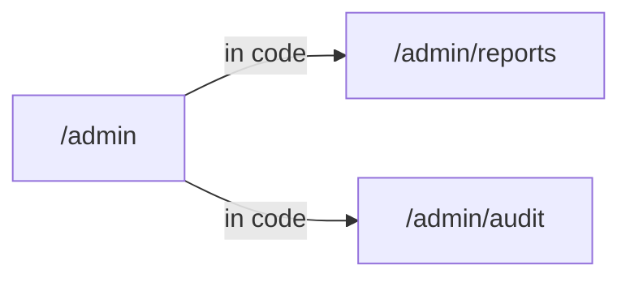

# Shop · Admin (AUT)

Part of [AUT_Shop](../AUT_Shop/SKILL.md). Generated from the Design Structure Matrix; business sections curated from the source code.

<!-- curated:start (written by Claude / QA from the source code; kept on regeneration) -->
## Business understanding
Summary: _(one sentence: what this module lets which users do; it is also used in this skill's description)_

_Not written yet. Claude (AUT-Skill-Builder): read this module's source files listed below through the code-repository
MCP server or the local clone, and the screens and forms in the generated facts, then describe:_
- _purpose of the module and the user roles that use it;_
- _business objects and their life cycle (states, transitions);_
- _business rules, calculations, validations, limits (cite `file:line`);_
- _integrations and data the module reads or writes (APIs, other modules, batch jobs)._
_Mark anything inferred rather than read in the code as **(inferred)**._

## End-to-end business cases
_Not written yet. One entry per real business case that touches this module, built from the candidate journeys and
dependencies below and confirmed in the code:_
- _**Name** · persona · preconditions and data · steps (screen → action → result) · expected business outcome ·
  modules involved · related candidate journey._
<!-- curated:end -->

<!-- generated:start (facts from the Design Structure Matrix; rewritten on regeneration, do not edit) -->
## Facts from the Design Structure Matrix
_DSM built 2026-10-29T07:21:47+00:00 from shop@cccccccc; skill generated 2026-10-29 11:16 UTC._

### Screens (3)

| Screen | Title | Reached from | Goes to | Forms · fields | Flags |
|---|---|---|---|---|---|
| `/admin` |  |  | /admin/audit, /admin/reports | 0 · 0 | orphan, code-only |
| `/admin/audit` |  | /admin |  | 0 · 0 | unresolved |
| `/admin/reports` |  | /admin |  | 0 · 0 | code-only |

### Screen details

#### `/admin`
- Found by: code
- Leads to: `/admin/reports` (in code), `/admin/audit` (in code)
- Route defined at: `shop:src/App.tsx:14`
- Source files: `shop:src/admin/Admin.tsx`

#### `/admin/audit`
- Found by: code-ref
- Reached from: `/admin` (in code)

#### `/admin/reports`
- Found by: code
- Reached from: `/admin` (in code)
- Route defined at: `shop:src/admin/Routes.tsx:3`

### Navigation within the component

### Dependencies on other components (from the DSM)

- Depends on (navigates to): none
- Used by (navigated from): none

### Candidate end-to-end journeys through this component

_None found in the DSM navigation._

### Test design notes
- **code-only**: `/admin`, `/admin/reports` — defined in code but not reached by the crawl (role, feature flag or data needed?)
- **unresolved**: `/admin/audit` — navigation target not defined anywhere (possible broken link)
- **orphan**: `/admin` — no screen links to it
- Design scenarios with the `Domain_Test_Design_Skill`; check impact of code changes with `/autonomous-qe:generate-dsm`.
<!-- generated:end -->
